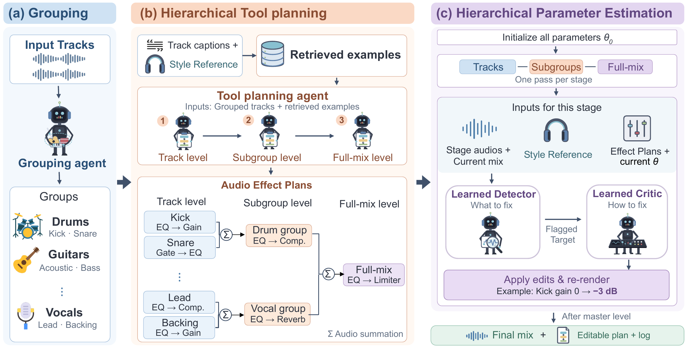

# MixAgent: Agentic Music Post-Production

[](https://arxiv.org/abs/2610.29093)
[](https://sonyresearch.github.io/Agentic_Music_Post-Production/)
[](https://huggingface.co/Jaywon17/MixAgent)

An agentic pipeline for music post-production that follows the workflow of audio engineers. Given the dry stems of a song and a reference mix, MixAgent groups the stems into buses, plans the effect chain of every stem, bus and the master, and then tunes the parameters level by level with a trained **detector** and a trained **critic**. The critic is trained with SFT followed by DPO on rendered audio outcomes.

<p align="center"></p>

## Installation

```bash
git clone https://github.com/SonyResearch/Agentic_Music_Post-Production.git
cd Agentic_Music_Post-Production

# agent + evaluation
conda create -n mixagent python=3.11 -y && conda activate mixagent
pip install -r setup/env_agent.txt --extra-index-url https://download.pytorch.org/whl/cu124

# critic (inference + training)
conda create -n mixagent-critic python=3.11 -y && conda activate mixagent-critic
pip install -r setup/env_critic.txt --extra-index-url https://download.pytorch.org/whl/cu126

# detector
conda create -n mixagent-detector python=3.10 -y && conda activate mixagent-detector
pip install -r setup/env_detector.txt --extra-index-url https://download.pytorch.org/whl/cu121

# planner
conda create -n mixagent-vllm python=3.11 -y && conda activate mixagent-vllm
pip install vllm==0.11.1 qwen-omni-utils==0.0.9
```

Download the base models (Stable Audio Open is gated, so accept its license on Hugging Face first) and the MixAgent weights:

```bash
hf auth login
bash setup/download_models.sh                    # into models/ (incl. RLAT from shlee-97/rlat)
hf download Jaywon17/MixAgent --local-dir weights
```

The weights hold six critics (`f1_sft`, `f1_dpo`, `f2_sft`, `f2_dpo`, `f3_sft`, `f3_dpo`) and the detector. The RLAT audio encoder ([arXiv:2608.28127](https://arxiv.org/abs/2608.28127)) is downloaded from [shlee-97/rlat](https://huggingface.co/shlee-97/rlat) by `setup/download_models.sh`. F1 critics give perceptual advice, F2 one comment per effect and F3 exact parameter values. `f3_dpo` is the main critic.

## Inference

```bash
# servers (one terminal each)
CUDA_VISIBLE_DEVICES=0 bash servers/serve_planner.sh
CUDA_VISIBLE_DEVICES=1 python servers/detector_server.py --port 8200 --device cuda:0
CUDA_VISIBLE_DEVICES=1 python servers/critic_server.py --critic f3_dpo --port 8201 --device cuda:0

# mix
python run_mixagent.py --dataset-root <dataset-root> --songs <song_id> --critic f3_dpo --out results/demo
```

The mix is written to `results/demo/mix/<song_id>/<song_id>.flac`, with its full mixing plan in `<song_id>_plan_final.json`. For your own song, `prepare_song.py` cuts the stems and the reference into the dataset format.

The tool-planning agent retrieves example mixes from a database of expert tool plans, which is not included. Without it, the agent plans without examples.

## Training

The critic is trained in three steps (shown for F3; use `f1` or `f2` for the others):

```bash
python critic/train.py --config critic/configs/sft/stage1_f3.yaml --gpu 0,1      # SFT stage 1: audio adapter
python critic/train.py --config critic/configs/sft/stage2_f3.yaml --gpu 0,1,2,3  # SFT stage 2: adapter + LoRA → f3_sft
python critic/train.py --config critic/configs/dpo/dpo_f3.yaml --gpu 0,1,2,3     # DPO → f3_dpo
```

Set `CRITIC_DATA` to your training data, laid out as below. Each row points to three audio clips (target element, current mix, reference); see `critic/examples/` for real rows.

```
$CRITIC_DATA/
├── sft/stage1_f3_{train,val}.jsonl
├── sft/stage2_f3_{train,val}.jsonl
└── dpo/f3_{train,val}.jsonl        # preference pairs (chosen / rejected critique)
```

DPO starts from the released `weights/critic/f3_sft.pt`. To start from your own SFT run, set `init_weights_from` in `critic/configs/dpo/dpo_f3.yaml`.

## Evaluation

```bash
python evaluation/score.py --run results/demo/mix --dataset-root <dataset-root>
```

The output is compared with the human mix in `GT/` after loudness normalization to −12 LUFS: MRS, MSS and AF, and the learned metrics TuneJury, FXenc++ and RLAT. The learned metrics need:

```bash
bash setup/download_models.sh eval
git clone https://github.com/yonghyunk1m/TuneJury && pip install -r TuneJury/requirements.txt
export TUNEJURY_ROOT=$PWD/TuneJury
```

## Dataset Format

```
<dataset-root>/
├── Input/<song_id>/*.flac       # dry stems
├── Reference/<song_id>.flac     # reference mix
└── GT/<song_id>.flac            # human mix (evaluation only)
```

The paper uses 15 s clips at 44.1 kHz, with stems at −16 LUFS and the reference at −12 LUFS.

## Citation

```bibtex
@article{koo2026agentic,
  title   = {Agentic Music Post-Production},
  author  = {Koo, Jaywon and Koo, Junghyun and Martinez-Ramirez, Marco A. and Liao, Wei-Hsiang and Doh, Seungheon and Wu, Qiyu and Ordonez, Vicente and Mitsufuji, Yuki},
  journal = {arXiv preprint arXiv:2610.29093},
  year    = {2026}
}
```
